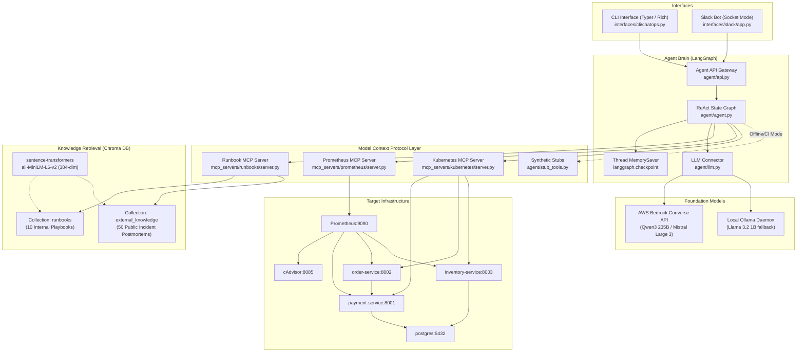
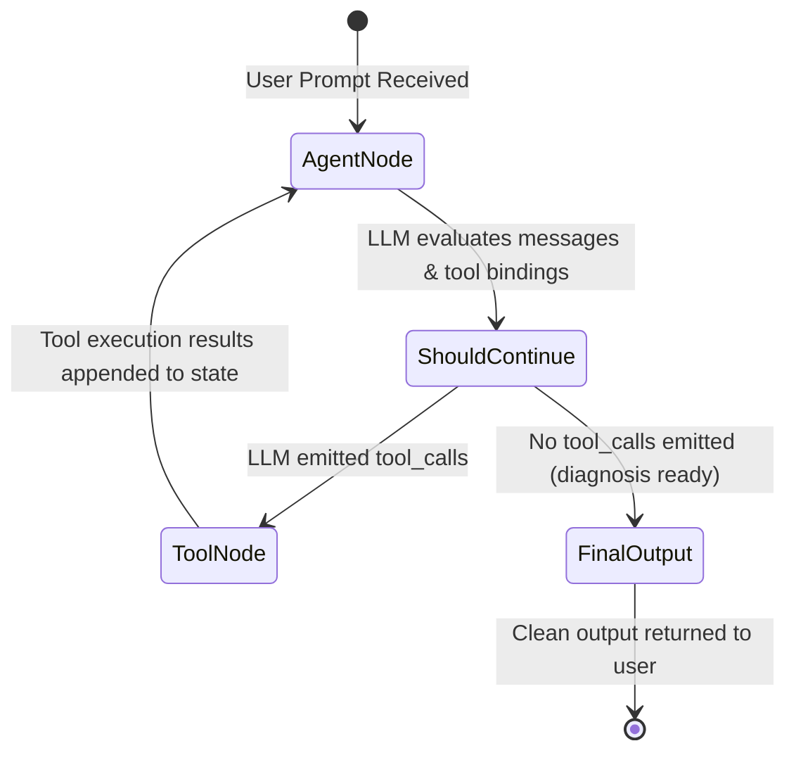
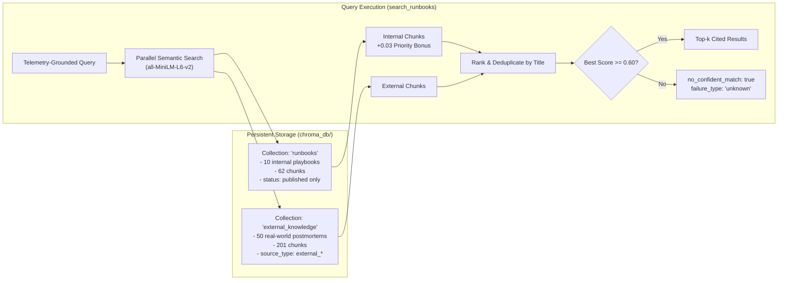
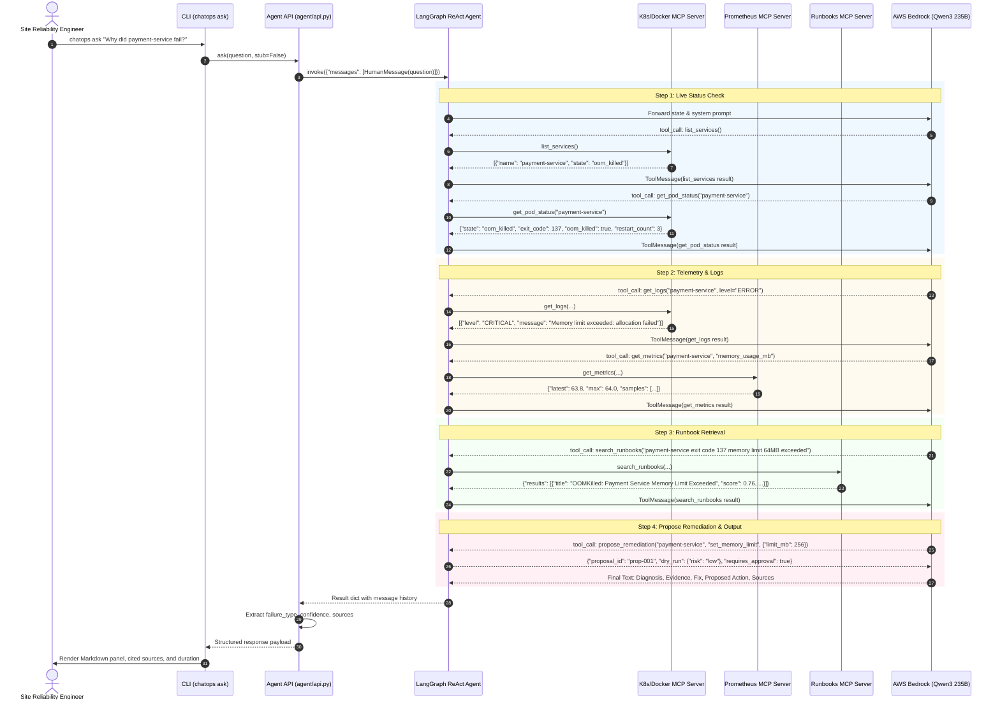

# ChatOps AI SRE Agent — System Architecture & Design Specification

> **Document ID:** `01-PROJECT-ARCHITECTURE`  
> **Target Audience:** Software Engineers, SREs, Technical Interviewers, System Architects  
> **Related Files:** [agent.py](file:///Users/nikhi/Desktop/Chatops/chatops-agent/agent/agent.py), [api.py](file:///Users/nikhi/Desktop/Chatops/chatops-agent/agent/api.py), [llm.py](file:///Users/nikhi/Desktop/Chatops/chatops-agent/agent/llm.py), [ingest.py](file:///Users/nikhi/Desktop/Chatops/chatops-agent/rag/ingest.py), [server.py (Runbooks)](file:///Users/nikhi/Desktop/Chatops/chatops-agent/mcp_servers/runbooks/server.py), [server.py (Prometheus)](file:///Users/nikhi/Desktop/Chatops/chatops-agent/mcp_servers/prometheus/server.py), [server.py (K8s)](file:///Users/nikhi/Desktop/Chatops/chatops-agent/mcp_servers/kubernetes/server.py)

---

## 1. Executive Summary & Real-World Purpose

The **ChatOps AI SRE Agent** is an autonomous, tool-using diagnostic and remediation-recommendation platform built to resolve microservice operational incidents. In production cloud environments, service degradation or container crashes trigger alarms that force Site Reliability Engineers (SREs) into high-friction, cognitive-heavy triage:
1. Navigating scattered Grafana metric dashboards.
2. Sifting through high-volume, unindexed container logs via `kubectl` or Docker CLI.
3. Checking container runtime lifecycle status (OOMKilled, exit codes, crash loops).
4. Searching fragmented, outdated Markdown runbooks or wikis.
5. Synthesizing disparate clues under time pressure (often at 2:00 AM) to formulate a root cause and recovery plan.

The ChatOps Agent solves this by acting as an autonomous SRE copilot. An engineer queries:
> *"Why did payment-service fail?"*

Instead of acting as a naive text chatbot that merely summarizes a document, the agent executes an **Evidence-First Protocol**:
- It inspects container runtime state, error logs, and Prometheus metrics first.
- It extracts ground-truth failure symptoms from real telemetry.
- It queries a dual-collection vector database (internal runbooks and curated public postmortems) using the observed symptoms.
- It outputs a structured, cited diagnosis with confidence scores and a non-destructive remediation proposal.
- It operates under a strict **Zero-Direct-Mutation Safety Boundary**, requiring explicit human-in-the-loop approval before any infrastructure change is applied.

```
+---------------------------------------------------------------------------------------+
|                                    USER INTERFACES                                    |
|         CLI (Typer + Rich)                             Slack Bot (Bolt Socket Mode)   |
+------------------------------------------+--------------------------------------------+
                                           |
                                           v
+---------------------------------------------------------------------------------------+
|                                   CHATOPS AGENT BRAIN                                 |
|                                                                                       |
|   +-------------------------------------------------------------------------------+   |
|   |                          LangGraph ReAct State Machine                        |   |
|   |                        (create_react_agent + MemorySaver)                     |   |
|   +---------------------------------------+---------------------------------------+   |
|                                           |                                           |
|                     +---------------------+---------------------+                     |
|                     |                                           |                     |
|                     v                                           v                     |
|        Foundation Model Layer                         Tool Orchestration              |
|        (AWS Bedrock Converse API /                    (Evidence-First Order)          |
|         Local Ollama Fallback)                                  |                     |
+---------------------+-------------------------------------------+---------------------+
                      |                                           |
                      |                                           v
                      |                         +-----------------------------------+
                      |                         |   Model Context Protocol (MCP)    |
                      |                         +-----------------+-----------------+
                      |                                           |
        +-------------+-------------+             +---------------+---------------+
        |                           |             |               |               |
        v                           v             v               v               v
+---------------+           +---------------+ +-----------+ +-----------+ +-----------+
| Internal RAG  |           | External RAG  | | Prometheus| | Container | | Remediate |
| Collection    |           | Collection    | | MCP       | | MCP (K8s/ | | Proposal  |
| (10 Runbooks, |           | (50 Real-World| | (PromQL   | | Docker)   | | (Dry-Run  |
| Chroma DB)    |           | Postmortems)  | | Telemetry)| | (Logs/Pods| | Generator)|
+---------------+           +---------------+ +-----+-----+ +-----+-----+ +-----+-----+
                                                    |             |             |
                                                    v             v             v
                                            +-----------------------------------------+
                                            |       TARGET MICROSERVICES & INFRA      |
                                            |  payment-service | order-service        |
                                            |  inventory-service | postgres | cadvisor|
                                            +-----------------------------------------+
```

---

## 2. Core Problem Solved & Value Proposition

### 2.1 The Operational Incident Triage Problem
Modern microservice architectures introduce severe operational complexity:
- **Cascading Failures:** A database connection timeout in `payment-service` bubbles up as an HTTP 502 Bad Gateway in `order-service`. A junior engineer troubleshooting `order-service` may misdiagnose it as an application bug in order placement rather than database connection starvation downstream.
- **Alert Fatigue & Signal Fragmentation:** Metrics reside in Prometheus/Grafana, logs reside in stdout/Elasticsearch/CloudWatch, and pod status is buried in `kubectl describe pod`. Correlating these across timestamps requires context switching across 4-6 tools.
- **Runbook Bit-Rot:** SRE runbooks are frequently out-of-sync with production configurations. When an incident occurs, engineers either cannot find the runbook or follow steps that no longer match reality.
- **Hallucination Risks in Generic LLM Assistants:** Feeding raw user complaints directly into standard LLMs often causes catastrophic hallucination. If a user asks *"Why did payment-service get OOM killed?"*, a standard RAG system immediately retrieves the OOM runbook and diagnoses OOMKilled—even if the actual cause was a PostgreSQL connection timeout.

### 2.2 Why This is Not "Just a Chatbot Over Docs"
The ChatOps SRE Agent implements four architectural paradigms that elevate it beyond standard retrieval-augmented generation:
1. **Tool-Using Agent via MCP (Model Context Protocol):** Telemetry inspection tools are formal MCP servers. The LLM acts as an active investigator that queries live container states, pulls error logs, and measures latency percentiles.
2. **Evidence-First Protocol:** The agent is constitutionally forbidden from querying runbooks until it has interrogated live container runtime state and log streams. The search query sent to the vector database is derived from *observed error tokens and telemetry signatures*, not user claims.
3. **Safety-Bounded Remediation Proposals:** Autonomous agents executing arbitrary shell commands or mutations in production pose critical reliability hazards. The agent has **no mutation tools**; it can only invoke `propose_remediation()`, which outputs a dry-run specification, risk classification, and rollback contingency for human sign-off.
4. **Guarded Continuous Learning Loop:** When novel failures occur, engineers run `chatops learn` to generate structured draft runbooks. Drafts are quarantined in `data/runbooks/drafts/` and strictly ignored by retrieval until an SRE reviews and executes `chatops approve`, preventing unverified playbooks from polluting the vector space.

---

## 3. High-Level System Architecture & Component Breakdown

The repository is cleanly partitioned into two distinct engineering domains:
- **Person A Domain (Brain / Reasoning):** LLM connections, LangGraph ReAct state machine, RAG ingestion pipelines, dual Chroma collections, CLI interface, and the `search_runbooks` MCP server.
- **Person B Domain (World / Telemetry):** FastAPI microservices, PostgreSQL database, Prometheus and Grafana monitoring stacks, cAdvisor container telemetry, failure injection scripts, Kubernetes manifests, Slack Bolt bot, and the Prometheus/Kubernetes MCP servers.

Communication between Person A and Person B components is strictly governed by contractual schemas defined in `contracts/mcp_tools.md`, `contracts/failure_types.md`, `contracts/logs.md`, and `contracts/metrics.md`.



---

## 4. Frontend & User Interface Architecture

The project provides two independent operator interfaces designed for distinct environments:

### 4.1 CLI Interface (`interfaces/cli/chatops.py`)
Built with **Typer** (CLI argument parser based on Python type hints) and **Rich** (terminal formatting, tables, panels, and spinners).

Key capabilities:
- `chatops ask "<question>"`: Dispatches incident queries to `agent.api.ask()`. Supports flags:
  - `--stub / --no-stub`: Toggles between synthetic in-process stubs and live MCP container/Prometheus backends.
  - `--model / -m`: Overrides the default model configured in `agent/config.yaml`.
  - `--multi`: Activates the parallel multi-agent coordinator (`LogAgent` + `MetricsAgent` + `EventsAgent`).
- `chatops search "<query>"`: Direct semantic search against Chroma DB without triggering an LLM reasoning loop.
- `chatops learn "<incident_notes>"`: Invokes `draft_runbook_from_incident()`, generating an unindexed draft in `data/runbooks/drafts/`.
- `chatops approve "<draft_filename>"`: Validates, publishes, moves, and indexes a draft into Chroma DB.

### 4.2 Slack Bot Interface (`interfaces/slack/app.py`)
Built using the **Slack Bolt for Python** framework running in **Socket Mode**.

Architectural highlights:
- **No Inbound Webhook Requirements:** Operates over an outbound WebSocket connection (`wss://wss-primary.slack.com/link`), eliminating the need for public static IPs, ngrok tunnels, or open inbound firewall ports.
- **Fast Acknowledgment (<3s Slack Rule):** Slack's API enforces a strict 3-second timeout for slash commands (`/chatops`) and event mentions (`@chatops`). To prevent timeouts during multi-second LLM reasoning, `app.py` acknowledges the event immediately (`ack()`), posts a temporary *"🔍 Investigating..."* message, and dispatches the actual agent invocation to a background daemon thread (`threading.Thread`).
- **Interactive Block Kit Responses:** Results are formatted into Slack Block Kit blocks displaying a confidence emoji (🟢 80-100%, 🟡 50-79%, 🔴 <50%), root cause analysis, affected service, latency, cited sources, and suggested remediations.
- **Multi-Turn Thread Memory:** The Slack thread timestamp (`thread_ts`) is forwarded to `agent.api.ask(thread_id=thread_ts)`, allowing engineers to ask follow-up questions within the same thread while preserving conversation context via LangGraph's `MemorySaver`.

---

## 5. Backend & Agent Reasoning Architecture

### 5.1 LangGraph ReAct State Machine
The core reasoning engine uses **LangGraph** (`langgraph.prebuilt.create_react_agent`).
Unlike legacy linear execution chains, LangGraph models agent execution as a cyclic directed graph:



1. **State:** A dictionary containing a list of `BaseMessage` objects (`HumanMessage`, `AIMessage`, `ToolMessage`, `SystemMessage`).
2. **`AgentNode`:** Sends the conversation history and system prompt to the LLM. The LLM either returns text or emits one or more structured `tool_calls`.
3. **`ToolNode`:** If `tool_calls` are present, LangGraph invokes the corresponding Python tool functions, wraps the results into `ToolMessage` instances, and loops back to `AgentNode`.
4. **Termination:** When the LLM decides it has accumulated sufficient evidence to satisfy the prompt's required output structure, it outputs text without tool calls, terminating the graph.

### 5.2 The Evidence-First Investigation Protocol
Defined in `AGENT_SYSTEM_PROMPT` inside `agent/agent.py` and `agent/api.py`, the agent is instructed to follow an invariant diagnostic sequence:
1. **Discover Runtime Topology:** Call `list_services()` to check registered services, then call `get_pod_status(service)` for the target service to establish baseline container state (`running`, `restarting`, `exited`, `oom_killed`, `unhealthy`).
2. **Inspect Telemetry & Logs:** Call `get_logs(service, level='ERROR')` to capture stack traces, unhandled exceptions, and exit codes. Call `get_metrics(service, ...)` to inspect memory RSS, CPU throttling, and error counters. Call `get_events(service)` for lifecycle warnings.
3. **Symptom-Grounded Runbook Query:** Invoke `search_runbooks(query=...)` using the *concrete error signatures found in Step 2* (e.g. `"payment-service exit code 137 memory limit 64MB exceeded"`) rather than the user's initial subjective prompt.
4. **Synthesize & Propose:** Structure the final diagnosis, verify that every statement cites a tool result or runbook, and call `propose_remediation()` to present a non-destructive recovery plan.

### 5.3 Foundation Model Integration (`agent/llm.py`)
The LLM connector supports seamless model swapping via `agent/config.yaml`:
- **Amazon Bedrock Converse API:** Utilizes `ChatBedrockConverse` from `langchain-aws`. Default model is `qwen.qwen3-vl-235b-a22b` in `us-east-1`.
  - **Automatic Cross-Region Inference Fallback:** Many Bedrock models require regional routing prefixes. `ChatBedrockConverseFallback` intercepts `ValidationException` (HTTP 400) and automatically retries with a `us.` prefix (e.g., `us.qwen.qwen3-vl-235b-a22b`), preventing configuration crashes.
  - **Reasoning-Leak Sanitization:** Advanced reasoning models emit internal thoughts wrapped in `<think>...</think>` tags or multi-part JSON blocks. `clean_output()` uses regex and block inspection to strip internal reasoning traces so only the final user-facing diagnosis is displayed.
- **Local Ollama Fallback:** Utilizes `ChatOllama` from `langchain-ollama` (defaulting to `llama3.2:1b` at `http://localhost:11434`), enabling full agent execution without cloud credentials or internet connectivity.

---

## 6. Knowledge Retrieval & Vector Database Architecture

The knowledge retrieval layer is implemented using **Chroma DB** and **sentence-transformers**.



### 6.1 Dual Collection Isolation
To prevent internal organizational runbooks from being overshadowed or contaminated by broad public documents, Chroma maintains two distinct collections:
1. `runbooks`: Contains verified internal operational runbooks (`data/runbooks/*.md`).
2. `external_knowledge`: Contains 50 curated real-world postmortems and official troubleshooting guides (Kubernetes, PostgreSQL, Docker, Prometheus, AWS/Cloudflare outages) located in `data/external/*.md`.

### 6.2 Chunking & Context Enrichment Strategy (`rag/ingest.py`)
1. **Section-Level Splitting:** Documents are split along `## Section Title` Markdown boundaries (`Symptoms`, `Likely cause`, `How to confirm`, `Fix`). This keeps operational instructions coherent within single chunks.
2. **Sub-chunking with Overlap:** Sections exceeding 600 characters are partitioned into sub-chunks with a 100-character overlap along sentence or newline boundaries.
3. **Context Enrichment:** Every chunk is prepended with top-level metadata headers:
   ```markdown
   # Runbook: OOMKilled: Payment Service Memory Limit Exceeded
   Service: payment-service | Failure Type: out_of_memory
   ## How to confirm
   <chunk content>
   ```
   This ensures that embeddings capture global document context even within deep subsections.
4. **Deterministic Idempotence:** Chunk IDs follow the schema `<filename>::<section>::<sub_idx>`. Re-running ingestion calls `collection.upsert()`, modifying chunks in-place without generating duplicates.
5. **Draft Quarantine:** Ingestion filters out any file with `status: draft` or located in `data/runbooks/drafts/`.

### 6.3 Confidence Thresholding & Unknown Fallback
Distance scores $D$ returned by Chroma (L2 distance on normalized embeddings) are mapped to similarity scores:
$$S = \frac{1}{1 + D}$$
- Exact matches yield $S \approx 1.0$.
- Known failure queries score between $0.65$ and $0.78$.
- Unrelated queries score $< 0.58$.

The server sets `CONFIDENCE_THRESHOLD = 0.60`. If all retrieved candidates fall below $0.60$, the tool returns `no_confident_match: true`. This signals the agent to avoid hallucinating a diagnosis and instead report `failure_type: "unknown"`, confidence `low`, list observed live evidence, and propose 2-3 unverified hypotheses with safe read-only commands.

---

## 7. Model Context Protocol (MCP) Integration

The **Model Context Protocol (MCP)** provides open, standard JSON-RPC 2.0 tool interfaces between the agent brain and operational environments.

### 7.1 Server Architecture
The repository runs three dedicated MCP servers:
1. `chatops-runbooks` (`mcp_servers/runbooks/server.py`): Managed by Person A. Exposes `search_runbooks(query, top_k, include_external)`.
2. `chatops-prometheus` (`mcp_servers/prometheus/server.py`): Managed by Person B. Exposes `get_metrics(service, metric, minutes)`.
3. `chatops-kubernetes` (`mcp_servers/kubernetes/server.py`): Managed by Person B. Exposes `get_pod_status(service)`, `get_events(service, minutes)`, `get_logs(service, minutes, level, limit)`, and `list_services()`.

### 7.2 Pluggable Container Backends (`mcp_servers/kubernetes/backends/`)
`server.py` delegates container operations to a pluggable `RuntimeBackend`:
- `DockerBackend` (`backends/docker_backend.py`): Uses `docker-py` to inspect local Docker containers, stream JSON logs, and read cgroup memory limits.
- `K8sBackend` (`backends/k8s_backend.py`): Uses the official Kubernetes Python client (`kubernetes.client.CoreV1Api`) to query Pod statuses, Pod events, and container log streams in a cluster or Minikube. Swapping between Docker and Kubernetes requires setting the environment variable `RUNTIME=k8s`.

---

## 8. Target Microservices & Failure Injection Architecture

The environment under diagnosis comprises three containerized FastAPI microservices backed by PostgreSQL and monitored by Prometheus and Grafana.

```
                     +---------------------------------------+
                     |         Load Generator (loadgen)      |
                     |         (~1-2 req/s synthetic traffic)|
                     +-------------------+-------------------+
                                         |
                                         v
+------------------+             +---------------+             +--------------------+
| inventory-service|             | order-service |             |  payment-service   |
|     (:8003)      |             |    (:8002)    |             |      (:8001)       |
+--------+---------+             +-------+-------+             +---------+----------+
         |                               | calls /pay                    |
         |                               +------------------------------>|
         |                                                               |
         | calls DB                      calls DB                        | calls DB
         v                               v                               v
+--------+-------------------------------+-------------------------------+----------+
|                                    PostgreSQL 15 Container                        |
|                                    (chatops database on :5432)                    |
+-----------------------------------------------------------------------------------+
```

### 8.1 Services Overview
- `payment-service` (Port 8001): Processes credit card transactions (`POST /pay`) and records rows in the `payments` table. Exposes diagnostic hooks:
  - `GET /leak`: Allocates 10 MB of non-garbage-collected bytearrays per invocation into a global list.
  - `GET /burn`: Executes CPU-bound arithmetic loops across multiple threads to saturate CPU cores.
- `order-service` (Port 8002): Accepts customer orders (`POST /orders`), calls `payment-service/pay` over HTTP via `httpx.AsyncClient`, and writes order state to PostgreSQL.
- `inventory-service` (Port 8003): Manages product stock records in PostgreSQL (`GET /stock/{item}`, `POST /stock/{item}`).

### 8.2 Standardized Observability
Every service implements identical telemetry contracts:
- **JSON Lines Logging (`app/logging_config.py`):** Outputs single-line JSON records to stdout matching `contracts/logs.md`:
  ```json
  {"timestamp": "2026-10-12T10:15:30.123Z", "service": "payment-service", "level": "ERROR", "message": "Database connection timed out after 5s", "extra": {"request_id": "abc123"}}
  ```
- **Prometheus Metrics (`app/metrics.py`):** Exposes metrics on `GET /metrics` matching `contracts/metrics.md`:
  - `http_requests_total{service, endpoint, status}` (Counter)
  - `http_request_duration_seconds{service, endpoint}` (Histogram)
  - `app_errors_total{service}` (Counter)
  - `app_memory_bytes{service}` (Gauge, updated by background thread via `psutil`)
  - `app_up{service}` (Gauge, 1 when healthy, 0 on failure)

### 8.3 Failure Scenarios & Ground Truth Generation (`infra/failures/`)
Six automated failure injection scripts simulate production incidents and generate evaluation data in `data/incident_logs/`:
1. `oom.py` (`oom-payment-001`): Lowers payment-service container memory to 64MB via `docker update --memory 64m`, hits `/leak` repeatedly until the Linux kernel OOM-killer terminates the container (exit code 137).
2. `bad_env.py` (`badenv-order-001`): Recreates `order-service` omitting `PAYMENT_SERVICE_URL`. The service fails startup validation and exits with code 1.
3. `health_fail.py` (`healthfail-inventory-001`): Toggles `health_fail=true` via `POST /admin/fault`. The `/health` endpoint returns 500, causing Docker/K8s to mark the container unhealthy.
4. `db_timeout.py` (`dbtimeout-payment-001`): Injects a 3-second sleep before database queries, causing upstream HTTP timeouts.
5. `dependency_failure.py` (`depfail-order-001`): Stops `payment-service`. `order-service` logs connection refused errors and returns HTTP 502 Bad Gateway.
6. `cpu_saturation.py` (`cpusat-payment-001`): Invokes `/burn` continuously while constraining CPU quota to 0.5 cores, generating high CPU throttling and latency spikes.

Each script produces two artifacts:
- `<scenario_id>.jsonl`: Real JSON logs emitted during the incident.
- `<scenario_id>.meta.json`: Ground truth metadata documenting `failure_type`, `root_cause`, `signals`, and `expected_fix` used by benchmark evaluators.

---

## 9. Application Lifecycle: Startup, Execution & Teardown



### 9.1 Teardown & State Restoration
When an incident is resolved or an engineer needs to restore the testing environment:
1. `python infra/manage.py restore` executes `infra/failures/restore.py`.
2. `restore.py` resets all Docker container memory limits back to baseline (128MB), restarts stopped containers, and issues HTTP calls to `POST /admin/fault` resetting all active fault toggles (`health_fail=false`, `slow_db=false`, `db_error=false`).
3. Services report healthy status (`app_up=1`), and Prometheus scrapers resume clean readings.

---

## 10. Architectural Explanation: Two Perspectives

### 10.1 Beginner / Junior Developer Explanation (Intuitive Analogy)
> Imagine you are a mechanic at a car repair shop. A customer drives in and says, *"My car won't start because the battery is dead!"*
> 
> A **bad mechanic** (a simple document chatbot) believes the customer immediately, goes to the bookshelf, pulls out the battery replacement manual, and charges the customer for a new battery. But the customer might be totally wrong—maybe the fuel tank was just empty!
> 
> Our **ChatOps Agent** is like an **expert master mechanic**:
> 1. It ignores the customer's guess for a moment and pops the hood.
> 2. It plugs in a diagnostic computer to check the battery voltage and fuel pressure (calling `get_pod_status` and `get_metrics`).
> 3. It checks the car's error codes on the dashboard (calling `get_logs`).
> 4. Only after discovering that the battery voltage is fine but the fuel pump has no power does it go to the bookshelf (`search_runbooks`) to look up the exact wiring diagram for the fuel pump.
> 5. Finally, it writes an inspection report for the customer with the evidence, but it **never** replaces any parts until the customer signs the approval work order (Safety Boundary).

### 10.2 Senior Software Engineering / System Interview Explanation
> The ChatOps SRE Agent implements an **Evidence-First ReAct state machine** hosted on LangGraph and exposed via Model Context Protocol (MCP) tool interfaces.
> 
> To mitigate hallucination cascades common in RAG-first architectures—where user queries introduce confirmation bias into vector similarity searches—the agent decouples symptom identification from knowledge retrieval. The state graph first interrogates runtime backends (Docker Engine API / Kubernetes CoreV1Api) and Prometheus HTTP query endpoints to construct an empirical symptom vector. Only then does it query a dual-collection vector database (Chroma DB indexed with 384-dimensional dense embeddings via `all-MiniLM-L6-v2`).
> 
> Retrieval separates verified internal runbooks from external public incident postmortems using isolated Chroma namespaces with deterministic chunk hashing and similarity threshold gating ($S \ge 0.60$). If no playbook satisfies the threshold, the system triggers an explicit `unknown` fallback rather than fabricating resolution steps.
> 
> Safety is structurally enforced through a **Zero-Direct-Mutation Boundary**: the execution graph lacks any tool with write/exec permissions against production infrastructure. Proposed mitigations are emitted as non-destructive dry-run specifications requiring cryptographic approval tokens before execution via human-in-the-loop interfaces.

---

## 11. Architectural Decisions, Trade-Offs & Alternatives

| Decision | Selected Approach | Alternative Considered | Trade-Off Justification |
|:---|:---|:---|:---|
| **Protocol** | Model Context Protocol (MCP) | Custom REST / JSON APIs | MCP provides standardized JSON-RPC schemas, dynamic tool discovery, and runtime decoupling between Person A (Python agent) and Person B (infra tools). REST would require manual schema updates in prompts. |
| **Investigation Flow** | Evidence-First Protocol | RAG-First Retrieval | RAG-First achieves only 60% accuracy because misleading user prompts pull wrong runbooks. Evidence-First achieves 90% accuracy by anchoring retrieval to verified live logs and metrics. |
| **Embeddings** | Local `all-MiniLM-L6-v2` | Cloud Titan / OpenAI Embeddings | MiniLM runs in-process on CPU in $<5$ ms per query with zero API costs, deterministic 384-dim vector space, and full offline/air-gapped operability without AWS keys. |
| **Agent Paradigm** | Monolithic ReAct with Stubs | Parallel Multi-Agent Specialists | Multi-agent was implemented and benchmarked (`LogAgent`, `MetricsAgent`, `EventsAgent`). At microservice scale, it achieved identical accuracy (90%) but incurred **2.4x higher token cost** ($0.0185 vs $0.0075) and **1.9x higher latency** (31.8s vs 16.4s). The monolithic ReAct agent was retained as default. |
| **Safety Model** | Zero Direct Mutations (Dry-Run Proposals) | Autonomous Self-Healing / Auto-Remediation | Direct LLM infrastructure mutations pose catastrophic risks (accidental `rm -rf`, premature restarts under DB locks). Enforcing human-in-the-loop approval guarantees operational safety. |
| **Vector DB** | Chroma DB (Embedded Persistent) | Pinecone / Qdrant / Pgvector | Embedded Chroma operates locally without cloud infrastructure dependencies, Docker networking overhead, or monthly hosting costs while supporting vector upsert and metadata filtering. |
