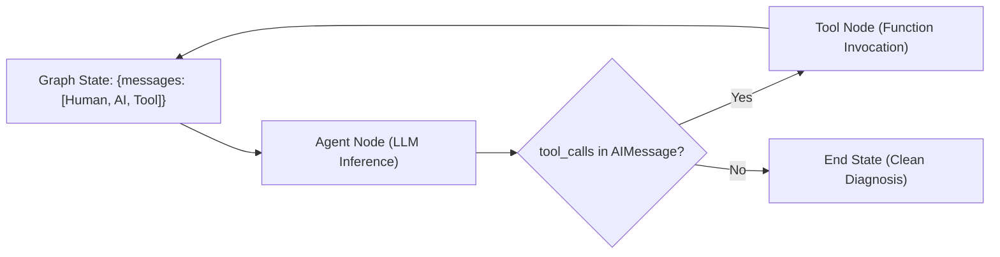

# ChatOps AI SRE Agent — Comprehensive Technology Deep-Dive

> **Document ID:** `04-TECHNOLOGY-DEEP-DIVE`  
> **Target Audience:** Software Engineers, Systems Programmers, SREs, Technical Interviewers  
> **Mission:** Master every language, framework, database, protocol, and tool in this project from fundamental principles to interview defense.

---

## 1. Python 3.11 / 3.14 (Core Runtime & Concurrency)

### 1.1 What It Is & Why It Exists
Python is a high-level, dynamically typed, interpreted programming language designed for readability, expressive syntax, and extensive standard library support. It is the de facto standard runtime for AI agents, machine learning, and systems orchestration.

### 1.2 Internal Working & Concurrency Model
- **CPython Virtual Machine:** Python source code (`.py`) compiles to bytecode (`.pyc`), executed by a stack-based virtual machine loop.
- **The Global Interpreter Lock (GIL):** In CPython, a mutex protects internal object memory against concurrent access, preventing multiple native OS threads from executing Python bytecode simultaneously. CPU-bound work cannot scale across multiple CPU cores on standard threads.
- **`asyncio` Event Loop:** Cooperative multitasking running on a single OS thread. The event loop polls an OS I/O multiplexer (`epoll` on Linux, `kqueue` on macOS) to pause coroutines awaiting network I/O (`await`) and resume them once file descriptors become readable/writable.
- **`threading` for Blocking I/O:** OS-level threads scheduled by the kernel. While constrained by the GIL for compute, Python releases the GIL during blocking system calls (socket read/write, file access, `time.sleep()`), allowing genuine I/O concurrency.

### 1.3 How It Is Used in This Project
- **Async I/O (`asyncio.gather`):** In `agent/multi/sub_agents.py`, three specialist sub-agents (`LogAgent`, `MetricsAgent`, `EventsAgent`) execute concurrent API calls to AWS Bedrock simultaneously.
- **Worker Threads (`threading.Thread`):** In `interfaces/slack/app.py`, Slack message handling is dispatched to background daemon threads to prevent blocking the WebSocket event loop.
- **Context Managers (`@asynccontextmanager`):** In `sample_apps/*/app/main.py`, FastAPI `lifespan` handles startup (PostgreSQL table verification, `app_up=1`) and shutdown.

### 1.4 Advantages & Disadvantages
- **Pros:** Unmatched AI/ML ecosystem (LangGraph, Chroma, PyTorch, HuggingFace), rapid prototyping, clean syntax.
- **Cons:** GIL limits CPU parallelism (though Python 3.13+ introduces experimental free-threaded builds); higher RAM usage and slower execution than Go or Rust.

### 1.5 Interview Questions & Answers
- **Q: Why did you use `asyncio.gather()` in `sub_agents.py` instead of Python `threading` or `multiprocessing`?**  
  *Answer:* Calling AWS Bedrock is an I/O-bound network task. `asyncio` is lightweight (cooperative user-space coroutines with minimal memory overhead), avoiding the memory overhead of separate OS processes (`multiprocessing`) or thread context switching (`threading`).
- **Q: How does the GIL affect the ChatOps agent?**  
  *Answer:* Because the agent primarily performs network I/O (Bedrock API calls, Prometheus queries, Docker socket requests), the GIL is released during socket waits. Thus, Python's GIL is not a performance bottleneck for our ChatOps agent.

---

## 2. LangGraph & LangChain (Agent State Machine & Graph Orchestration)

### 2.1 What It Is & Why It Exists
LangGraph is an orchestration framework that models LLM agent execution as a stateful, cyclic directed graph. LangChain provides the foundational abstractions for models, prompts, tools, and message types.

### 2.2 How It Works Internally

- **StateGraph:** A graph parameterized by a state schema (in our case, `{"messages": list[BaseMessage]}`).
- **Cyclic Execution:** Unlike linear DAGs, agents require cyclic loops where tool results are fed back into the LLM until a stopping condition is reached.
- **`create_react_agent`:** A prebuilt factory that wires an LLM, a list of tool functions, and a system prompt into a standard ReAct (Reasoning + Acting) cyclic state graph.
- **`MemorySaver` Checkpointer:** Stores snapshots of the graph state after every node execution in memory, indexed by `configurable: {"thread_id": "..."}`.

### 2.3 How It Is Used in This Project
- **Agent Definition (`agent/agent.py` & `agent/api.py`):** Compiles the primary ReAct agent with 6 bound MCP tools and the Evidence-First constitutional prompt.
- **Multi-Turn Slack Conversations:** In `agent/api.py`, `_MEMORY = MemorySaver()` enables the Slack bot to recall previous diagnostic steps when an SRE asks follow-up questions in a thread.

### 2.4 Common Mistakes & Pitfalls
- **Infinite Tool Loops:** If the LLM repeatedly calls the same tool with identical arguments when an error occurs. Prevented by returning structured `{"error": "..."}` dicts from tools so the LLM understands the failure and adjusts its strategy.
- **Prompt State Bloat:** Appending hundreds of raw log lines to `messages` rapidly exhausts the model's context window. Solved by truncating log output to the top 100 lines and summarizing tool outputs.

### 2.5 Interview Questions & Answers
- **Q: Why choose LangGraph over traditional LangChain `AgentExecutor`?**  
  *Answer:* LangChain deprecated `AgentExecutor` because it was a rigid, black-box abstraction. LangGraph provides transparent, inspectable cyclic state graphs, first-class human-in-the-loop breakpoints, and explicit checkpointing (`MemorySaver`).
- **Q: How does LangGraph invoke tool functions?**  
  *Answer:* The LLM emits an `AIMessage` with a `tool_calls` payload containing the function name and JSON arguments. LangGraph maps the name to the Python function wrapped with `@tool`, executes it, and appends a `ToolMessage` with the serialized output to the message history.

---

## 3. Amazon Bedrock Converse API & Foundation Models

### 3.1 What It Is & Why It Exists
Amazon Bedrock is a fully managed cloud service that provides high-performance foundation models from leading AI companies (Anthropic, Mistral, Meta, Qwen, Cohere) via a single unified API. The **Converse API** standardizes tool calling, system prompts, and multi-turn conversations across all supported model families.

### 3.2 Key Models Evaluated in This Project
1. **`qwen.qwen3-vl-235b-a22b` (Default Primary Model):**
   - 235B parameter mixture-of-experts model.
   - Selected for high tool-calling precision (100% adherence to JSON schemas), fast inference (~1.5–2.0s per step), and superior reasoning over complex systems.
2. **`mistral.mistral-large-3-675b-instruct`:** Evaluated for high speed (1.03s latency) and zero reasoning token leakage.
3. **`deepseek.v3.2` & `moonshotai.kimi-k2.5`:** Evaluated for cost efficiency in high-frequency SRE operations.

### 3.3 Critical Technical Implementations in `agent/llm.py`
- **Automatic Cross-Region Fallback (`ChatBedrockConverseFallback`):** AWS frequently routes high-demand models through cross-region inference profiles requiring a `us.` prefix. Our custom subclass intercepts `ValidationException` (HTTP 400) and automatically retries with `us.<model_id>`.
- **Reasoning Token Sanitization (`clean_output`):** Reasoning models emit internal chain-of-thought blocks (`<think>...</think>`). Our regex filter strips these blocks so internal reasoning tokens never reach the user.

### 3.4 Interview Questions & Answers
- **Q: Why use the Bedrock Converse API instead of raw vendor APIs?**  
  *Answer:* The Converse API standardizes tool definitions and response schemas across multiple foundation models. Switching from Qwen to Mistral or Claude requires changing one line in `config.yaml` with zero prompt rewriting or tool schema refactoring.
- **Q: What is a Bedrock Cross-Region Inference Profile?**  
  *Answer:* AWS dynamic routing that balances inference requests across multiple AWS regions (e.g., `us-east-1`, `us-west-2`) to avoid capacity constraints. Profiles are prefixed with `us.` or `eu.`.

---

## 4. Model Context Protocol (MCP)

### 4.1 What It Is & Why It Exists
The Model Context Protocol (MCP) is an open specification initiated by Anthropic that standardizes how AI applications connect to external tools, data sources, and runtime environments over JSON-RPC 2.0.

### 4.2 How It Works Internally
```
Client (Agent)                              Server (Prometheus MCP)
      |                                                |
      | ----------> tools/list (JSON-RPC) -----------> |
      | <---------- list of schemas <----------------- |
      |                                                |
      | ----------> tools/call (get_metrics) --------> |
      | <---------- result payload <------------------ |
```
- **Transport Agnostic:** Runs over `stdio` (stdin/stdout pipes) for local processes, and HTTP with Server-Sent Events (SSE) for remote microservices.
- **Dynamic Schema Discovery:** Clients query the server for supported tools, parameter types, and descriptions using standard JSON Schema.
- **Error Handling Contract:** Tools must return `{"error": "message"}` rather than raising process-terminating exceptions, enabling the LLM to inspect errors and self-correct.

### 4.3 Implementation in This Project
- **`mcp_servers/runbooks/server.py`:** Person A's server exposing `search_runbooks`.
- **`mcp_servers/prometheus/server.py`:** Person B's server exposing `get_metrics`.
- **`mcp_servers/kubernetes/server.py`:** Person B's server exposing `get_pod_status`, `get_logs`, `get_events`, and `list_services`.

### 4.4 Interview Questions & Answers
- **Q: Why use MCP instead of standard FastAPI REST endpoints for agent tools?**  
  *Answer:* MCP standardizes tool discovery, schema validation, and execution semantics over a single protocol. The agent can dynamically inspect tool definitions without hardcoded API client code.
- **Q: What happens if an MCP server crashes during a tool call?**  
  *Answer:* The client receives a broken pipe or connection error. In our architecture, the LangChain tool wrapper catches the exception and returns `{"error": "Tool execution failed: <details>"}`, allowing the agent to handle the failure gracefully.

---

## 5. Chroma DB & Dense Vector Search

### 5.1 What It Is & Why It Exists
Chroma DB is an open-source, embedded vector database designed for AI applications. It manages document chunking, embedding generation, approximate nearest neighbor (ANN) indexing, and metadata filtering.

### 5.2 How It Works Internally
- **HNSW (Hierarchical Navigable Small World):** A multi-layer graph-based index for fast approximate nearest neighbor search in sub-millisecond time ($O(\log N)$ search complexity).
- **SQLite Metadata Backing:** Documents, metadata dicts, and IDs are stored in an embedded SQLite database (`chroma.sqlite3`), while vector indices are persisted as binary link lists in `chroma_db/`.
- **Embedding Function (`all-MiniLM-L6-v2`):** A 384-dimensional bi-encoder model running locally on CPU via `sentence-transformers`.
- **Distance Metric:** Squared L2 distance, normalized to similarity score $S = \frac{1}{1 + D}$.

### 5.3 Implementation in This Project
- **Dual Collections:** `runbooks` (internal playbooks) and `external_knowledge` (50 public postmortems).
- **Idempotent Upsert:** Deterministic IDs (`{filename}::{section}::{idx}`) ensure re-running `rag/ingest.py` updates vectors in-place without duplicates.
- **Confidence Threshold:** `CONFIDENCE_THRESHOLD = 0.60` flags unknown failures (`no_confident_match: true`).

### 5.4 Interview Questions & Answers
- **Q: Why use local `all-MiniLM-L6-v2` instead of OpenAI `text-embedding-3-small` or Bedrock Titan?**  
  *Answer:* MiniLM runs locally on CPU in $<5$ ms per query with zero API costs, operates air-gapped/offline, and provides deterministic 384-dimensional embeddings across all development environments.
- **Q: What is the difference between Cosine Distance and L2 Distance?**  
  *Answer:* When vectors are $L_2$-normalized to unit length ($\|v\| = 1$), squared L2 distance is monotonically related to cosine distance: $\|u - v\|^2 = 2 - 2 \cos(u, v)$. Chroma operates efficiently on normalized embeddings.

---

## 6. FastAPI & Uvicorn (Target Microservices)

### 6.1 What It Is & Why It Exists
FastAPI is a modern, high-performance web framework for building APIs with Python 3.8+ based on standard Python type hints. Uvicorn is a lightning-fast ASGI (Asynchronous Server Gateway Interface) web server implementation based on `uvloop` and `httptools`.

### 6.2 Key Concepts
- **ASGI Specification:** Enables asynchronous handling of long-lived connections, WebSockets, and non-blocking HTTP requests.
- **Pydantic Validation:** Request payloads are parsed, validated, and coerced into typed Python data classes at the HTTP boundary.
- **Lifespan Context Manager:** Replaces legacy startup/shutdown event decorators, providing structured async setup and teardown.

### 6.3 Implementation in This Project
- **Sample Microservices:** `payment-service` (:8001), `order-service` (:8002), and `inventory-service` (:8003) in `sample_apps/`.
- **Fault Toggles:** Controlled via startup environment variables or runtime HTTP calls to `POST /admin/fault`.

### 6.4 Interview Questions & Answers
- **Q: Why use FastAPI for sample microservices instead of Flask?**  
  *Answer:* Native async support for high-throughput concurrency, automatic OpenAPI documentation, integrated Pydantic validation, and clean Prometheus metric endpoint integration.

---

## 7. Prometheus, PromQL & cAdvisor (Observability Stack)

### 7.1 What It Is & Why It Exists
Prometheus is a time-series database (TSDB) and monitoring system based on an active pull model. PromQL is its domain-specific query language. cAdvisor (Container Advisor) provides resource usage and performance metrics for running Docker containers.

### 7.2 Core Metric Types
| Metric Type | Meaning | Project Example |
|:---|:---|:---|
| **Counter** | Monotonically increasing cumulative metric | `http_requests_total`, `app_errors_total` |
| **Gauge** | Value that can arbitrarily go up and down | `app_memory_bytes`, `app_up` |
| **Histogram** | Samples observations (usually request durations) into configurable buckets | `http_request_duration_seconds` |

### 7.3 Key PromQL Queries in This Project
- **Error Rate:** `sum by (service) (rate(app_errors_total[1m]))`
- **Memory Consumption:** `sum(app_memory_bytes{service="payment-service"}) / 1048576` (MB)
- **Container Memory vs Limit (cAdvisor):**  
  `container_memory_usage_bytes{name="payment-service"} / container_spec_memory_limit_bytes{name="payment-service"} * 100`

### 7.4 Interview Questions & Answers
- **Q: Why is Prometheus pull-based rather than push-based?**  
  *Answer:* Pull architecture allows the monitoring system to detect outages easily (if a scrape fails, the target is down), prevents monitoring backends from being overwhelmed during traffic spikes, and eliminates the need to push metric endpoint credentials to application servers.
- **Q: How does `rate()` work in PromQL?**  
  *Answer:* `rate()` calculates the per-second average rate of increase of a counter over a specified time window, automatically handling counter resets (e.g., when a process restarts).

---

## 8. Docker, cgroups & Linux Container Runtime

### 8.1 What It Is & Why It Exists
Docker packages applications and their dependencies into standardized, portable Linux containers using OS-level virtualization.

### 8.2 Internal Mechanisms
- **Linux Namespaces:** Provide isolation (PID, NET, MNT, IPC, UTS, USER).
- **Control Groups (cgroups v2):** Enforce hard resource boundaries on CPU, memory, and I/O.
  - Setting `deploy.resources.limits.memory: 128M` configures `memory.max` in the container's cgroup.
- **The Linux OOM Killer:** When a container process allocates memory beyond its cgroup `memory.max` and swap is exhausted, the kernel invokes `oom_kill_process()`, sending `SIGKILL` (signal 9). Docker inspects this and records `ExitCode: 137` ($128 + 9$) and `OOMKilled: true`.

### 8.3 Implementation in This Project
- `infra/docker-compose.yml` provisions the entire 8-container stack.
- `infra/failures/oom.py` uses `docker update --memory 64m` to induce deterministic OOM crashes.

### 8.4 Interview Questions & Answers
- **Q: Why does an OOM-killed container exit with code 137?**  
  *Answer:* In Linux, process termination by an unhandled signal produces an exit status equal to $128 + N$, where $N$ is the signal number. The Linux kernel sends `SIGKILL` (signal 9) during an OOM event: $128 + 9 = 137$.
- **Q: What is the difference between Docker `healthcheck` and Kubernetes probes?**  
  *Answer:* Docker healthchecks mark containers as `healthy` or `unhealthy` but do not restart them unless managed by a higher-level orchestrator. Kubernetes uses `livenessProbe` (restarts container on failure) and `readinessProbe` (removes container from service traffic routing on failure).

---

## 9. Technology Matrix & Interview Preparation Checklist

| Technology | Concept to Master | Where It Appears in Code | Interview Question |
|:---|:---|:---|:---|
| **Python** | `asyncio.gather` vs threads | `agent/multi/sub_agents.py` | "Why use coroutines over threads for LLM API calls?" |
| **LangGraph** | Cyclic state graphs & checkpointers | `agent/agent.py`, `agent/api.py` | "How does `MemorySaver` preserve Slack conversation state?" |
| **Bedrock** | Converse API & cross-region profiles | `agent/llm.py` | "How do you prevent reasoning token leaks and handle regional quotas?" |
| **MCP** | JSON-RPC 2.0 tool definitions | `mcp_servers/*/server.py` | "Why use MCP instead of standard REST endpoints?" |
| **Chroma DB** | HNSW vector indexing & upsert | `rag/ingest.py`, `mcp_servers/runbooks` | "Explain how deterministic chunk IDs enable idempotent indexing." |
| **FastAPI** | Lifespan context & JSON logging | `sample_apps/*/app/main.py` | "How do you guarantee contract-compliant JSON logs during startup crashes?" |
| **Prometheus** | PromQL rate calculation & TSDB | `infra/prometheus/`, `mcp_servers/prom` | "How does PromQL calculate p95 latency from histogram buckets?" |
| **Docker** | cgroups v2 & exit code 137 | `infra/docker-compose.yml`, `oom.py` | "Walk me through how the Linux kernel OOM killer interacts with Docker." |
| **Slack Bolt** | Socket Mode & background worker ACK | `interfaces/slack/app.py` | "How do you satisfy Slack's 3-second ACK rule during multi-step LLM reasoning?" |
